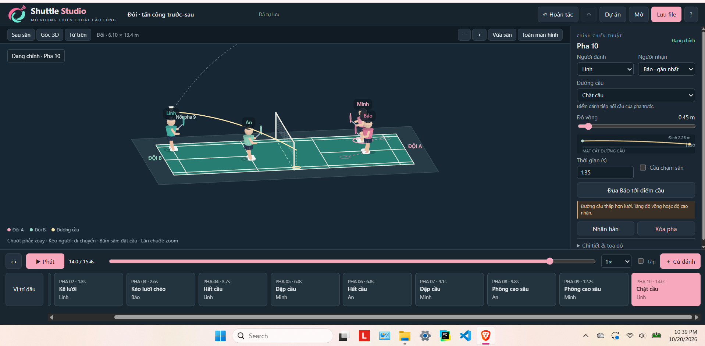
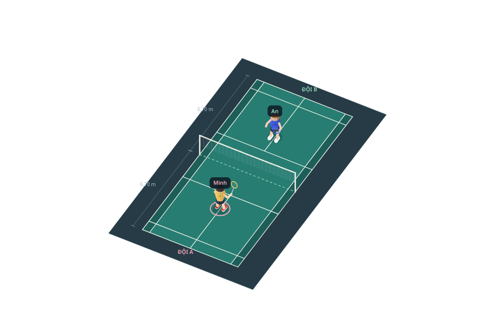

<p align="center">
  
</p>

<h1 align="center">Shuttle Studio</h1>

<p align="center"><b>Mô phỏng chiến thuật cầu lông 3D ngay trên trình duyệt — không cần cài đặt, không cần mạng.</b></p>

<p align="center">Phiên bản 1.5.0 · Giấy phép MIT · Chạy offline 100%</p>

Shuttle Studio là sa bàn cầu lông 3D để bạn **đặt người chơi, thiết kế chuỗi cú đánh và di chuyển, rồi phát lại** để giảng giải chiến thuật. Mọi dữ liệu do bạn tự thiết lập — không AI nhận dạng video, không tài khoản, không máy chủ.



## Dùng thử ngay

- **Bản web (GitHub Pages):** 
- **Chạy trên máy, không cần mạng:** tải file **`MO_UNG_DUNG.html`** trong repo này (hoặc bản ZIP ở mục Releases), mở bằng Chrome/Edge là dùng ngay. Toàn bộ ứng dụng nằm trong đúng 1 file HTML.
- **Chạy từ source:** mở `index.html` cùng thư mục với `core.js`, `app.js`, `style.css`.

## Tính năng

**Sa bàn & chuỗi pha**
- Sân 3D chuẩn tỉ lệ (đơn 5,18 m / đôi 6,10 m × 13,40 m), lưới và vạch kẻ đầy đủ; xoay tự do, góc từ trên, góc sau sân, zoom.
- Đánh đơn (2 người) và đôi (4 người); kéo người trên sân hoặc nhập tọa độ chính xác; mỗi người luôn bị giữ đúng nửa sân của đội mình.
- Chuỗi "pha" nối liền nhau: điểm kết thúc của pha trước là điểm bắt đầu của pha sau (cả vị trí lẫn độ cao cầu). Thêm, xóa, nhân bản pha; hoàn tác/làm lại; phát/dừng, tua timeline, lặp, chỉnh tốc độ.
- 13 loại đường cầu: phông cao sâu, phông lao, bỏ nhỏ, kê lưới, kéo lưới chéo, đập, hất cầu, đánh ngang, chém, chặt, đẩy, giao cầu ngắn, giao cầu cao sâu.

**Uốn đường cầu theo ý muốn**
- Kéo **trực tiếp đường cầu màu vàng** trên sân 3D hoặc trong biểu đồ mặt cắt: lên/xuống thay độ vồng, kéo ngang dời **vị trí đỉnh** của quỹ đạo.
- Đỉnh lệch sớm cho đường lài, rơi nhanh (chặt cầu, drive); lệch muộn cho phông treo cao rồi rơi thẳng. App cảnh báo khi đường cầu thấp hơn lưới.

**Tùy chỉnh nhân vật**
- Tay cầm vợt **trái/phải** cho từng người.
- 4 kiểu tóc (Ngắn, Dựng, Dài, Búi) và bảng màu cho **áo, quần, giày, da, tóc** — kèm ô chọn màu tự do; chép thiết kế cho đồng đội trong một cú bấm (chế độ đôi).

**Dự án & chia sẻ**
- Lưu/mở file JSON (định dạng có kiểm tra hợp lệ), tự lưu dự phòng trong trình duyệt.
- Mẫu chiến thuật đơn và đôi có sẵn; thống kê số pha/loại cầu/người đánh.
- Lật ngang chiến thuật, đổi đầu sân, xuất ảnh sân PNG, chế độ toàn màn hình để trình chiếu.



## Điều khiển & phím tắt

| Việc cần làm | Thao tác |
|---|---|
| Xoay góc nhìn | Chuột phải + kéo |
| Di chuyển người | Chuột trái + kéo nhân vật |
| Đặt điểm cầu | Bấm trái vào sân trống phía đối phương |
| Uốn đường cầu | Kéo đường vàng trên sân hoặc trên biểu đồ mặt cắt |
| Zoom | Lăn chuột hoặc nút +/− |
| Phát / dừng | Phím `Space` |
| Chuyển pha | Phím `←` / `→` |
| Dừng để chỉnh pha đang xem | `Esc` |
| Hoàn tác / làm lại | `Ctrl+Z` / `Ctrl+Shift+Z` |

## Phát triển

Yêu cầu: Node.js (chỉ để chạy test) và Python 3 (chỉ để build lại bản gộp).

```sh
npm install   # cài jsdom cho bộ test
npm test      # 58 bài kiểm thử logic + giao diện
python build.py   # sửa source xong chạy lệnh này để tạo lại MO_UNG_DUNG.html
```

Cấu trúc thư mục:

```
index.html        Khung giao diện
style.css         Toàn bộ CSS
core.js           Logic thuần: hình học sân, quỹ đạo cầu, dữ liệu, kiểm tra hợp lệ (không phụ thuộc DOM)
app.js            Giao diện, vẽ Canvas 2D theo phép chiếu 3D, tương tác kéo thả
MO_UNG_DUNG.html  Bản gộp 1 file để dùng ngay (sinh ra bởi build.py — đừng sửa tay)
build.py          Script đóng gói
examples/         Hai chiến thuật mẫu (đơn/đôi) dạng JSON
tests/            Bộ test Node + jsdom
logo/             Bộ logo chính thức và các kích thước icon
docs/             Ảnh minh họa cho README
```

Định dạng dữ liệu: file JSON `format: "shuttle-tactics"`, `version: 2`. Mỗi pha gồm người đánh, điểm đến, loại cầu, độ vồng (`height`), vị trí đỉnh (`peak`, 0.1–0.9), độ cao điểm nhận, thời lượng, vị trí cuối của 4 người và ghi chú. Ngoại hình nhân vật nằm ở trường `appearance` (màu áo/quần/giày/da/tóc, kiểu tóc, tay vợt). File của các bản cũ (kể cả 1.0) vẫn mở được; mở file lạ hoặc hỏng sẽ bị từ chối thay vì làm hỏng dữ liệu hiện tại.

## Giới hạn hiện tại

- Quỹ đạo cầu là mô hình minh họa (bump hai nửa parabol), không mô phỏng vật lý, xoáy cầu hay lực cản không khí.
- Hình 3D vẽ bằng Canvas 2D với phép chiếu tự viết, không dùng WebGL; thứ tự che khuất là xấp xỉ.
- Chưa xuất video, chưa có chấm luật thi đấu đầy đủ. Thiết bị chính là máy tính; điện thoại xem được nhưng thao tác kéo sẽ khó hơn.

## Đưa lên GitHub Pages (cho chủ repo)

1. Đẩy toàn bộ nội dung thư mục này lên repository (giữ nguyên cấu trúc).
2. Vào **Settings → Pages → Build and deployment → Source: Deploy from a branch**, chọn nhánh `main`, thư mục `/ (root)`, bấm **Save**.
3. Chờ 1–2 phút, GitHub cho một đường link dạng `https://<tên-bạn>.github.io/shuttle-studio/` — dán link đó vào mục "Dùng thử ngay" ở đầu README này.

## Giấy phép

MIT — xem file [LICENSE](LICENSE). Bạn được tự do dùng, sửa và chia sẻ lại; ghi nguồn là một lời cảm ơn đẹp.

## Ghi chú

Dự án cá nhân làm bằng "vibe coding" để học và để chia sẻ với cộng đồng cầu lông. Góp ý và báo lỗi xin mở **Issue** trên GitHub.
