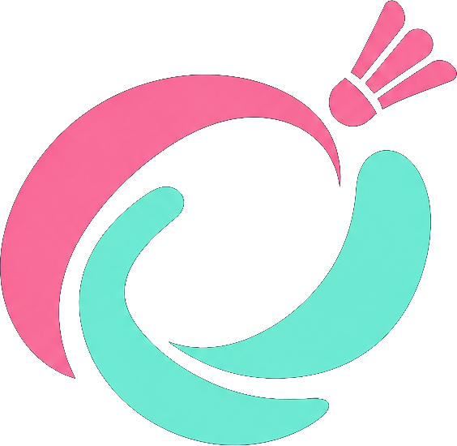
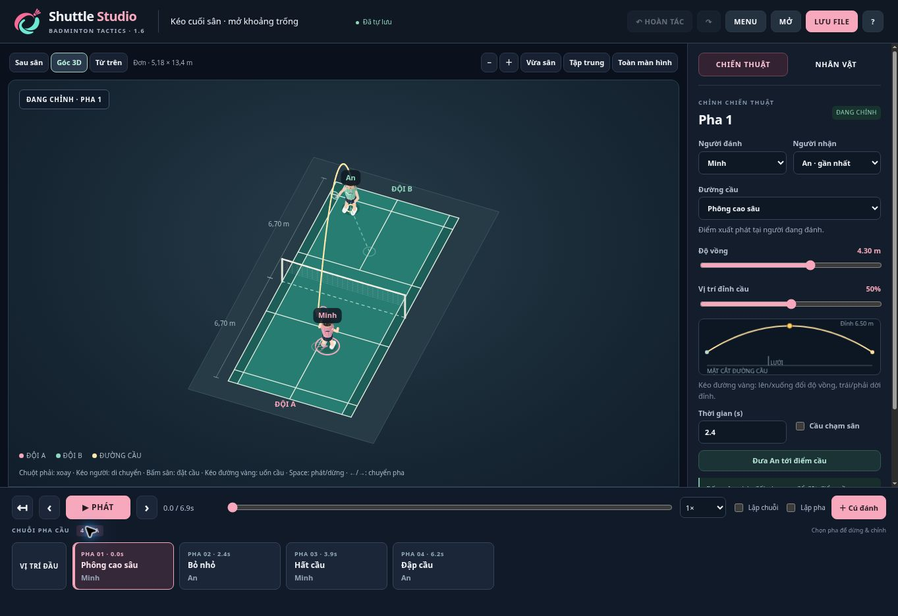

<p align="center">
  
</p>
<h1 align="center">Shuttle Studio</h1>
<p align="center"><b>Đặt đội hình. Thiết kế đường cầu. Xem lại chiến thuật.</b></p>
<p align="center">Sa bàn cầu lông 3D trên trình duyệt · Phiên bản 1.6.0</p>
<p align="center">
  <a href="https://bachkhi29.github.io/shuttle-studio/"><b>DÙNG THỬ</b></a> ·
  <a href="#dùng-offline">TẢI OFFLINE</a> ·
  <a href="https://github.com/bachkhi29/shuttle-studio/issues/new/choose">BÁO LỖI</a>
</p>



Shuttle Studio giúp người chơi và người hướng dẫn cầu lông tự dựng tình huống, bố trí người, thiết kế chuỗi cú đánh và phát lại để trao đổi chiến thuật. Giao diện mang phong cách game thể thao; đây là **công cụ minh họa chiến thuật**, không phải game thi đấu hay hệ thống AI phân tích video.

## Bắt đầu trong 3 bước

1. **Mở mẫu:** vào **Menu → Mẫu đơn / Mẫu đôi**, hoặc bắt đầu từ mẫu đang hiển thị.
2. **Chỉnh trên sân:** chọn một thẻ pha, kéo người, bấm sân đối phương để đặt điểm cầu. Kéo đường vàng hoặc thanh độ vồng để điều chỉnh quỹ đạo.
3. **Xem và lưu:** bấm **Phát**, bật **Lặp pha** nếu muốn xem kỹ; bấm **Lưu file** để giữ chiến thuật dưới dạng JSON.

> Bấm một thẻ pha luôn dừng phát để chỉnh. Chỉ nút **Phát** mới bắt đầu chạy lại.

## Có gì trong app?

| Công việc | Tính năng |
|---|---|
| Dựng tình huống | Đơn / đôi; sân đúng tỉ lệ; giữ người ở nửa sân của đội mình |
| Thiết kế đường cầu | 13 loại cầu; kéo trực tiếp độ vồng và vị trí đỉnh; nối điểm cuối pha trước vào pha sau |
| Xem lại | Phát / dừng, tua, tốc độ 0.25×–2×, lặp chuỗi hoặc lặp riêng một pha |
| Tùy chỉnh người chơi | Tay trái / phải, kiểu tóc, màu áo, quần, giày, da và tóc |
| Trình bày | Góc 3D, từ trên, sau sân; chế độ Tập trung; toàn màn hình; xuất ảnh PNG |
| Quản lý chiến thuật | Lưu / mở JSON, tự lưu trên trình duyệt, hoàn tác / làm lại, mẫu đơn / đôi, thống kê |

Bản 1.6 sửa lỗi vẽ đảo tay cầm vợt, tách tab **CHIẾN THUẬT / NHÂN VẬT** và giữ thanh phát cùng danh sách pha ở cuối màn hình. Tay trái/phải tính theo **cơ thể nhân vật**, không theo bên trái/phải của màn hình. Xem [lịch sử cập nhật](CHANGELOG.md).

## Điều khiển

| Thao tác | Điều khiển |
|---|---|
| Xoay sân | Chuột phải + kéo |
| Di chuyển người | Chuột trái + kéo nhân vật |
| Đặt điểm nhận cầu | Bấm sân trống phía đối phương |
| Uốn đường cầu | Kéo đường vàng hoặc đồ thị mặt cắt |
| Thu / phóng | Lăn chuột hoặc nút − / + |
| Phát / dừng | `Space` |
| Chuyển pha và dừng | `←` / `→` hoặc nút ‹ / › |
| Chỉnh pha đang xem | `Esc` |
| Hoàn tác / làm lại | `Ctrl+Z` / `Ctrl+Shift+Z` |

## Dùng offline

1. Mở [MO_UNG_DUNG.html](MO_UNG_DUNG.html) trên GitHub, bấm **Download raw file** để tải về. Hoặc chọn **Code → Download ZIP** rồi giải nén.
2. Mở file bằng Chrome hoặc Edge. Bản HTML gộp hoạt động độc lập, không cần cài Node.js hay Python.
3. Bấm **Lưu file** trong app để sao lưu chiến thuật. Dữ liệu tự lưu chỉ nằm trong trình duyệt; mở bản web và bản offline có thể sử dụng vùng lưu khác nhau.

Không cần tài khoản hoặc máy chủ xử lý. Bản web cần mạng để tải trang; file HTML tải về có thể chạy offline.

## Phát triển

Source dùng HTML, CSS và JavaScript thuần. Chạy test với Node.js 22; đóng gói bằng Python 3.12:

```sh
npm ci
python build.py
npm test
```

Xem [hướng dẫn phát triển và GitHub Pages](docs/DEVELOPMENT.md), [kết quả kiểm tra](QA.md) và [ngữ cảnh bàn giao](CONTEXT_AI.md).

## Giới hạn

- Đường cầu phục vụ minh họa; chưa mô phỏng chính xác lực cản không khí, xoáy cầu hoặc kỹ thuật vung vợt.
- Hình sân và người được vẽ bằng Canvas 2D với phép chiếu 3D; che khuất là xấp xỉ, không dùng WebGL.
- Chưa xuất video hoặc tự chấm luật thi đấu. Máy tính với chuột là thiết bị sử dụng chính; màn hình nhỏ dùng bảng chỉnh cuộn riêng.
- Kiểm thử tự động không bảo đảm ứng dụng không còn lỗi trên mọi trình duyệt hoặc thiết bị.

## Đóng góp

Dự án cá nhân của **Lý Đình Bách**, phát triển để học và chia sẻ với cộng đồng cầu lông. Khi [báo lỗi](https://github.com/bachkhi29/shuttle-studio/issues/new/choose), vui lòng ghi phiên bản, trình duyệt, các bước tái hiện và ảnh hoặc JSON mẫu nếu có.

Giấy phép: [MIT](LICENSE).
